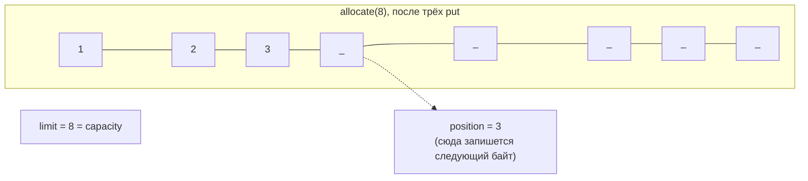

# 1. ByteBuffer: анатомия

`ByteBuffer` — не «массив с методами», а **окно** над блоком памяти с четырьмя числами состояния:

| Поле | Смысл | Меняется |
|---|---|---|
| `capacity` | размер блока, не меняется никогда | при создании |
| `position` | индекс, с которого произойдёт следующее чтение/запись | после каждого `get`/`put` |
| `limit` | первый индекс, к которому **нельзя** обращаться | `flip()`, `limit(n)` |
| `mark` | запомненная позиция для `reset()` | `mark()` |

Инвариант: `0 ≤ mark ≤ position ≤ limit ≤ capacity`.



```java
void example() {
    ByteBuffer buffer = ByteBuffer.allocate(8);   // pos=0 lim=8 cap=8
    buffer.put((byte) 1).put((byte) 2).put((byte) 3);   // pos=3 lim=8 cap=8
}
```

Один и тот же буфер работает в **двух режимах**, и переключает их программист, а не буфер:

| Режим | position указывает | limit указывает | Что делаем |
|---|---|---|---|
| Запись (после `allocate`/`clear`/`compact`) | куда писать дальше | на конец блока | `put`, `channel.read(buffer)` |
| Чтение (после `flip`) | откуда читать дальше | на конец данных | `get`, `channel.write(buffer)` |
