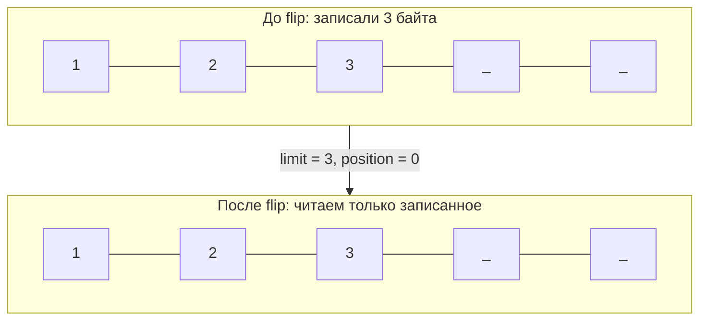

# 3. flip(): зачем он нужен

`flip()` превращает «записали сколько-то байт» в «вот ровно столько можно прочитать»:

```
limit = position;
position = 0;
mark сбрасывается
```



| Момент | position | limit | capacity |
|---|---|---|---|
| `allocate(8)` | 0 | 8 | 8 |
| `put` × 3 | 3 | 8 | 8 |
| `flip()` | **0** | **3** | 8 |
| `get` × 2 | 2 | 3 | 8 |

Что будет, если `flip()` забыть (реальный прогон):

```java
void example() {
    ByteBuffer buffer = ByteBuffer.allocate(8);
    buffer.put((byte) 1).put((byte) 2).put((byte) 3);

    byte b = buffer.get();   // БЕЗ flip -> 0: читаем «пустое место» с позиции 3, а не наши данные
    // position стал 4 — данные 1, 2, 3 остались позади
}
```

| Ошибка | Симптом |
|---|---|
| Нет `flip()` перед чтением | читаются нули/мусор после последней записи |
| Нет `flip()` перед `channel.write(buffer)` | в сеть/файл уходит 0 байт (`remaining() == 0`) |
| Двойной `flip()` | `limit` становится равным 0 — буфер «пуст» |
