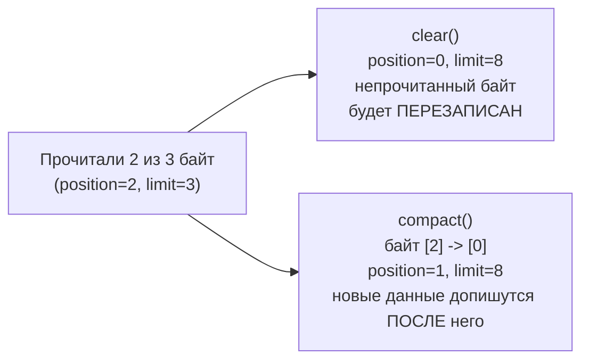

# 4. rewind, clear, compact, mark/reset

| Метод | position | limit | Данные | Когда |
|---|---|---|---|---|
| `flip()` | 0 | = старая position | сохраняются | записали -> читаем |
| `rewind()` | 0 | не меняется | сохраняются | перечитать то же с начала |
| `clear()` | 0 | = capacity | **не стираются**, просто считаются «свободными» | всё прочитали -> пишем заново |
| `compact()` | = remaining | = capacity | непрочитанное сдвигается в начало | прочитали **часть** -> дописываем в хвост |
| `mark()` / `reset()` | `reset` возвращает position к метке | не меняется | сохраняются | прочитать вперёд и вернуться |

```java
void example() {
    ByteBuffer buffer = ByteBuffer.wrap(new byte[]{10, 20, 30, 40});
    buffer.get();                 // 10, position=1
    buffer.mark();                // запомнили позицию 1
    buffer.get();                 // 20
    buffer.get();                 // 30, position=3
    buffer.reset();               // position снова 1 -> следующий get() вернёт 20
    buffer.rewind();              // position=0 -> всё сначала
}
```

`clear()` против `compact()` — самое важное различие в работе с сетью:



`clear()` корректен, только если прочитано **всё**. Если из сети пришло «полтора сообщения»,
`clear()` потеряет половину второго, `compact()` — нет.
