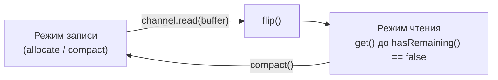

# 5. Чтение из канала: правильный цикл

Канал **пишет в** буфер (`channel.read(buffer)`), приложение **читает из** буфера — поэтому на одном
шаге цикла режим переключается дважды:



```java
void readAll(SocketChannel channel) throws IOException {
    ByteBuffer buffer = ByteBuffer.allocate(4096);
    while (channel.read(buffer) != -1) {      // канал дописывает в буфер с position
        buffer.flip();                        // теперь читаем то, что пришло
        while (buffer.hasRemaining()) {
            process(buffer.get());
        }
        buffer.compact();                     // непрочитанное — в начало, снова пишем
    }
}
```

Что возвращает `channel.read(buffer)`:

| Значение | Смысл |
|---|---|
| `> 0` | прочитано столько байт; `position` сдвинулся на столько же |
| `0` | сейчас данных нет (в неблокирующем режиме) **или** в буфере нет места (`remaining() == 0`) |
| `-1` | соединение закрыто собеседником (EOF) |

Как это сделано в нашем `Reactor` — и почему там нет `flip()`:

```java
ByteBuffer buffer = ByteBuffer.allocate(4096);
int read = channel.read(buffer);
...
exchange.responseBuffer.write(buffer.array(), 0, read);   // берём первые `read` байт из массива
```

| Решение в `Reactor` | Плюс | Цена |
|---|---|---|
| Читаем из `buffer.array()` напрямую | не нужен `flip()` | работает только для heap-буфера (`hasArray()`) |
| Новый `ByteBuffer.allocate(4096)` на каждое событие | просто | лишние аллокации; в «боевом» коде буфер переиспользуют и делают `clear()` |
| Накапливаем ответ в `ByteArrayOutputStream` до `-1` | не нужно разбирать `Content-Length` | возможно только потому, что запрос шлёт `Connection: close` |
