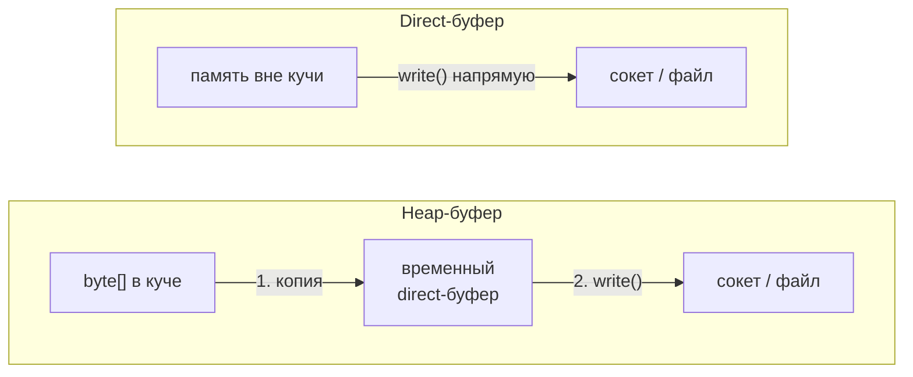

# 7. Heap и Direct: в чём разница

| | `HeapByteBuffer` | `DirectByteBuffer` |
|---|---|---|
| Создание | `ByteBuffer.allocate(n)`, `ByteBuffer.wrap(array)` | `ByteBuffer.allocateDirect(n)` |
| Где память | в куче JVM — внутри `byte[]` | вне кучи (native memory процесса) |
| `hasArray()` / `array()` | `true` / доступен | `false` / `UnsupportedOperationException` |
| `isDirect()` | `false` | `true` |
| Учёт GC | сборщик мусора двигает и освобождает | не двигается; освобождается, когда GC соберёт сам объект буфера — **не детерминированно** |
| Лимит | `-Xmx` | `-XX:MaxDirectMemorySize` (по умолчанию ≈ `-Xmx`); при исчерпании — `OutOfMemoryError: Direct buffer memory` |
| Создание | дёшево | заметно дороже (системный вызов выделения памяти) |

Главная причина существования direct-буферов — **лишняя копия при вводе-выводе**:



Системные вызовы ОС работают с памятью, которую GC не перемещает. Куча перемещается — поэтому при
`channel.write(heapBuffer)` JDK сначала копирует байты во временный direct-буфер (он кешируется на
поток) и только потом отдаёт ОС.

| Когда что брать | Выбор |
|---|---|
| Маленькие сообщения, учебный код, данные потом разбираются в Java-объекты (`Reactor`, 4 КБ на запрос) | heap — проще и дешевле создавать |
| Долгоживущие буферы для частого/объёмного ввода-вывода (серверы, Netty) | direct, **переиспользуемый** (пул) — цена создания окупается |
| Нужен `array()` (передать в API, принимающее `byte[]`) | только heap |
| Короткоживущие direct-буферы «на каждый запрос» | антипаттерн: дорогое выделение + нагрузка на сборку мусора |

```java
void example() {
    ByteBuffer heap = ByteBuffer.allocate(1024);
    ByteBuffer direct = ByteBuffer.allocateDirect(1024);

    System.out.println(heap.hasArray());     // true
    System.out.println(direct.hasArray());   // false
    System.out.println(direct.isDirect());   // true
}
```
