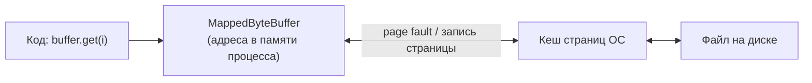

# 8. MappedByteBuffer

Файл отображается в адресное пространство процесса: чтение/запись байта буфера — это чтение/запись
страницы памяти, которую ОС сама подгружает из файла (и сама сбрасывает обратно).



```java
void example() throws IOException {
    try (FileChannel channel = FileChannel.open(path, StandardOpenOption.READ, StandardOpenOption.WRITE)) {
        MappedByteBuffer mapped = channel.map(FileChannel.MapMode.READ_WRITE, 0, 1024);

        mapped.put(0, (byte) 42);   // запись в память = запись в файл (в кеше страниц ОС)
        mapped.force();             // принудительно сбросить изменения на диск
    }
}
```

| `MapMode` | Запись | Попадает в файл |
|---|---|---|
| `READ_ONLY` | `ReadOnlyBufferException` | — |
| `READ_WRITE` | разрешена | да, и видна другим процессам, отобразившим тот же файл |
| `PRIVATE` | разрешена (copy-on-write) | нет — изменения видны только этому буферу |

| Метод | Что делает |
|---|---|
| `force()` | сбросить изменения на устройство хранения (для `READ_WRITE`); без него запись «уйдёт» когда ОС решит |
| `load()` / `isLoaded()` | подсказка ОС загрузить страницы в память заранее / проверить, загружены ли |
| `isDirect()` | всегда `true`; `hasArray()` — всегда `false` |

Ограничения, о которых важно знать:

| Ограничение | Следствие |
|---|---|
| Размер одного отображения ≤ `Integer.MAX_VALUE` (≈ 2 ГБ) | файл больше — отображать по частям |
| Нет метода `unmap()` | память отображения освобождается, когда GC соберёт буфер; на Windows файл нельзя удалить, пока жив маппинг |
| Первое обращение к странице — page fault | задержка непредсказуема (может уйти на диск), в отличие от `byte[]` в куче |
| Ошибка ввода-вывода при обращении к памяти | не `IOException`, а аварийное завершение/`InternalError` — проверок «на лету» нет |

Современная замена (JDK 22+, FFM API): `FileChannel.map(mode, offset, size, Arena)` возвращает
`MemorySegment` с **детерминированным** освобождением через `Arena.close()` и без лимита в 2 ГБ.
