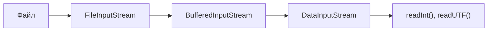

# 1. java.io: потоки

Поток — **однонаправленная труба байт**: из `InputStream` только читают, в `OutputStream` только
пишут, и каждый вызов ждёт, пока операция не завершится.

| Класс | Единица данных | Назначение |
|---|---|---|
| `InputStream` / `OutputStream` | байты | базовый уровень: файл, сокет, массив |
| `Reader` / `Writer` | символы | мост «байты ↔ текст» с учётом кодировки |
| `BufferedInputStream`, `BufferedReader` | то же | буфер в памяти: меньше системных вызовов |
| `DataInputStream` / `DataOutputStream` | `int`, `long`, `UTF` | запись/чтение примитивов (так устроена история цен в проекте) |

Потоки **оборачивают друг друга** (паттерн Decorator):



```java
void example() throws IOException {
    try (DataInputStream in = new DataInputStream(
            new BufferedInputStream(Files.newInputStream(path)))) {
        String ticker = in.readUTF();
        long epochMillis = in.readLong();
    }
}
```

Контракт `read`, о котором часто забывают:

| Вызов | Возвращает | Подвох |
|---|---|---|
| `in.read()` | один байт `0..255` или `-1` (EOF) | `-1` — конец потока, не байт |
| `in.read(byte[] buf)` | сколько байт реально прочитано или `-1` | **может быть меньше `buf.length`** даже без EOF — читать в цикле |
| `in.readNBytes(n)` / `readAllBytes()` | гарантированно до `n` / до конца | сами делают цикл за вас |

`try-with-resources` обязателен: незакрытый поток — утечка файлового дескриптора.
