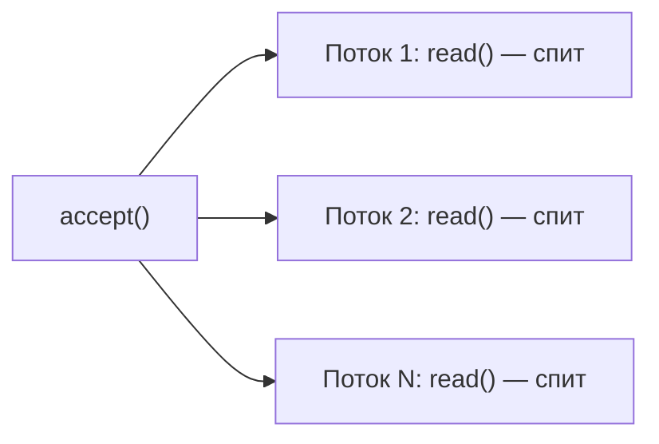

# 2. Блокировка и поток на соединение

Вызов `read()` у потока **останавливает вызывающий поток**, пока не появятся данные. Для сетевого
сервера это значит: пока соединение открыто, поток на него занят целиком.

```java
void server() throws IOException {
    try (ServerSocket server = new ServerSocket(8080)) {
        while (true) {
            Socket socket = server.accept();               // блокируется до нового клиента
            new Thread(() -> handle(socket)).start();      // отдельный поток на каждое соединение
        }
    }
}

void handle(Socket socket) {
    try (socket) {
        InputStream in = socket.getInputStream();
        int b = in.read();                                 // этот поток спит, пока клиент молчит
    } catch (IOException e) {
        // соединение оборвано
    }
}
```



| Свойство | Следствие |
|---|---|
| Поток ↔ соединение 1:1 | 10 000 клиентов = 10 000 потоков |
| Большую часть времени поток ничего не делает | память на стек и работа планировщика тратятся впустую |
| Простая линейная логика обработки | код легко читать и отлаживать — главное достоинство модели |

Клиентская сторона зеркальна: наш `HttpUrlConnectionTInvestApiClient` при `getResponseCode()` тоже блокирует
поток до ответа — разбор масштаба проблемы на слайдах [«Путь к Reactor»](../Путь%20к%20Reactor/2.%20Масштаб%20проблемы.md).
