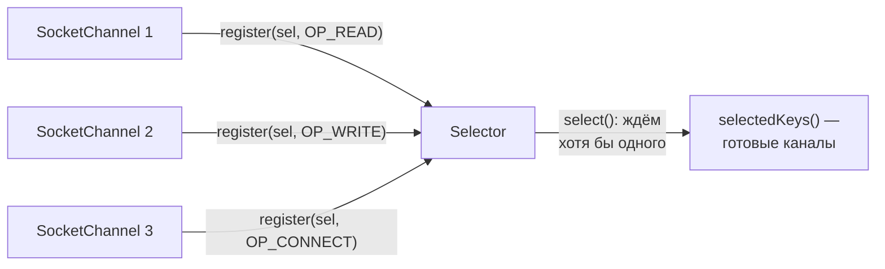

# 5. Selector и SelectionKey

`Selector` — «диспетчер готовности»: каналы регистрируются в нём с **интересом** (`interestOps`), а
`select()` блокирует поток **один раз** на все каналы, пока хотя бы один не станет готов.



| `interestOps` | Готов, когда |
|---|---|
| `OP_CONNECT` | TCP-рукопожатие завершено (`finishConnect()` не блокирует) |
| `OP_READ` | есть байты, читать можно без ожидания |
| `OP_WRITE` | в буфере отправки есть место, писать можно без ожидания |
| `OP_ACCEPT` | у `ServerSocketChannel` есть входящее соединение (в нашем клиенте не используется) |

Каркас цикла событий (так устроен наш `Reactor`):

```java
void loop(Selector selector) throws IOException {
    while (true) {
        selector.select();                              // блокируемся ОДИН раз на все каналы
        for (SelectionKey key : selector.selectedKeys()) {
            if (key.isConnectable()) {
                ((SocketChannel) key.channel()).finishConnect();
                key.interestOps(SelectionKey.OP_WRITE); // следующий шаг — запись
            } else if (key.isReadable()) {
                // читаем из key.channel() в ByteBuffer, данные запроса — в key.attachment()
            }
        }
        selector.selectedKeys().clear();                // иначе те же ключи придут снова
    }
}
```

| Элемент | Зачем |
|---|---|
| `channel.register(selector, ops, attachment)` | привязать канал к селектору и положить рядом **состояние запроса** (`attachment`) |
| `key.interestOps(...)` | сменить, чего ждём, по ходу работы (connect -> write -> read) |
| `selectedKeys().clear()` | селектор сам ключи из набора не убирает |
| `selector.wakeup()` | разбудить `select()` из другого потока — например, когда пришёл новый запрос на регистрацию |
| Канал должен быть неблокирующим | `register` на блокирующем канале бросает `IllegalBlockingModeException` |
