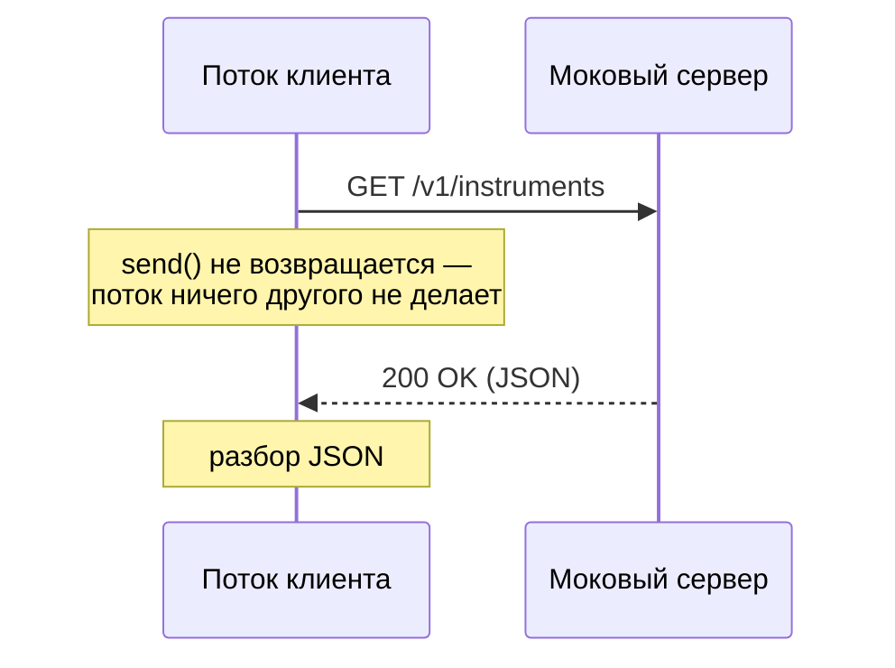

# 1. Блокирующий клиент

Наш опорный клиент (`HttpUrlConnectionTInvestApiClient`, этап 2) на классическом
`HttpURLConnection` делает один блокирующий вызов:

```java
int status = connection.getResponseCode();   // поток стоит здесь, пока не придёт ответ
```



| Фаза | Что делает поток | Процессор |
|---|---|---|
| Сборка и отправка запроса | работает | занят |
| Ожидание ответа сервера | спит внутри `send()` | свободен |
| Разбор JSON | работает | занят |

Время запроса почти целиком уходит на **ожидание**, а не на вычисления, — и поток всё это время
принадлежит одному запросу. Сам по себе один запрос — не проблема; проблема начинается, когда
запросов много (следующий слайд).
