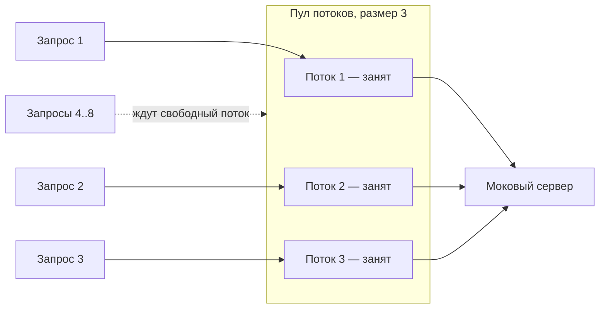

# 2. Масштаб проблемы

`BlockingClientDemo`: пул из **3** потоков, **8** одновременных запросов, моковый сервер отвечает за
≈ 300 мс. Реальный вывод:

```
[   0 мс] pool-2-thread-1 запрос #0: отправлен
[   0 мс] pool-2-thread-2 запрос #1: отправлен
[   0 мс] pool-2-thread-3 запрос #2: отправлен
[ 436 мс] pool-2-thread-1 запрос #0: получен ответ (ждал 436 мс)
...
[ 436 мс] pool-2-thread-3 запрос #5: отправлен       <- только теперь стартовал 4-й запрос
...
[1053 мс] pool-2-thread-1 запрос #6: получен ответ (ждал 307 мс)

Все 8 запросов завершены за 1054 мс.
```



| Запросов | Потоков в пуле | Волн | Время ≈ |
|---|---|---|---|
| 8 | 3 | ⌈8 / 3⌉ = 3 | 3 × 300 мс ≈ 900–1000 мс |
| 8 | 8 | 1 | ≈ 300 мс |
| 10 000 | 3 | 3 334 | ≈ 1000 с |

Закономерность: время ≈ ⌈N / размер пула⌉ × задержка сервера. Лечится размером пула — но поток ОС
стоит дорого:

| Одновременных соединений | Потоков | Память только на стеки (≈ 1 МБ/поток) |
|---|---|---|
| 100 | 100 | ≈ 100 МБ |
| 1 000 | 1 000 | ≈ 1 ГБ |
| 10 000 | 10 000 | ≈ 10 ГБ |

Это классическая проблема **C10K**: модель «поток на соединение» упирается в память и в планировщик
ОС задолго до того, как упрётся реальная пропускная способность сети.
