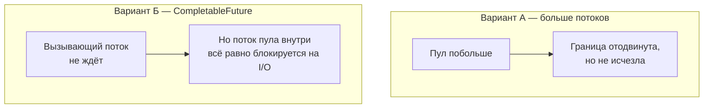

# 3. Наивные решения и их потолок



**Вариант А.** Просто увеличить пул:

```java
void example() {
    ExecutorService pool = Executors.newFixedThreadPool(1000);   // 1000 потоков ОС
    // каждый стоит ≈ 1 МБ стека + работа планировщика ОС
}
```

**Вариант Б.** Не ждать результат в вызывающем потоке:

```java
void example() {
    CompletableFuture
            .supplyAsync(() -> client.fetchQuotes())   // поток общего пула вызывает БЛОКИРУЮЩИЙ fetchQuotes
            .thenAccept(System.out::println);
    // вызывающий код не блокируется — но поток внутри supplyAsync всё равно спит на сокете
}
```

| | Больше потоков | `CompletableFuture` поверх блокирующего клиента |
|---|---|---|
| Что решает | пропускную способность до предела пула | освобождает **вызывающий** поток |
| Что не решает | память и планировщик на масштабе | поток внутри `supplyAsync` блокируется так же |
| Вывод | та же проблема, другой порог | асинхронный интерфейс ≠ неблокирующая реализация |

`CompletableFuture` — это **способ описать** результат «когда-нибудь», а не способ **дождаться
сокета без потока**. Для второго нужна поддержка от ОС — слайд 5.
