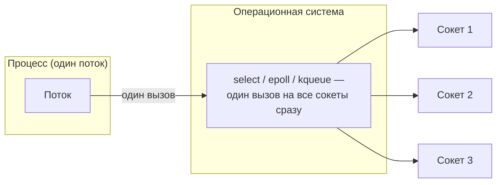

# 5. ОС умеет ждать на нескольких сокетах разом

Вместо «поток на сокет» — один вызов ОС: «разбуди меня, когда **хотя бы один** из этих сокетов
станет готов».

| Механизм | ОС | Сложность на N сокетов | Ограничения |
|---|---|---|---|
| `select` | POSIX (везде) | O(N): ядро сканирует все сокеты при каждом вызове | обычно ≤ 1024 (`FD_SETSIZE`) |
| `poll` | POSIX | O(N) | лимита нет, но тот же линейный скан |
| `epoll` | Linux | O(готовых): ядро само ведёт список готовых | лимита нет |
| `kqueue` | BSD, macOS | как `epoll` | лимита нет |
| IOCP | Windows | модель завершения операций (иная схема) | — |

Как выглядит `epoll` на уровне ОС — три вызова вместо сканирования:

| Вызов | Что делает | Аналог в Java |
|---|---|---|
| `epoll_create` | создаёт объект-наблюдатель | `Selector.open()` |
| `epoll_ctl(ADD, fd, события)` | добавляет сокет и интересующие события | `channel.register(selector, ops)` |
| `epoll_wait` | блокируется, пока что-то не готово, возвращает список готовых | `selector.select()` + `selectedKeys()` |

`java.nio.channels.Selector` — кроссплатформенная обёртка: `SelectorProvider` при старте JVM сам
выбирает реализацию под текущую ОС (`epoll` на Linux, `kqueue` на macOS), прикладной код об этом не
знает.
