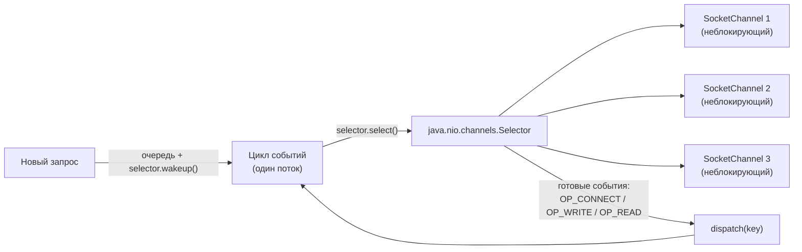
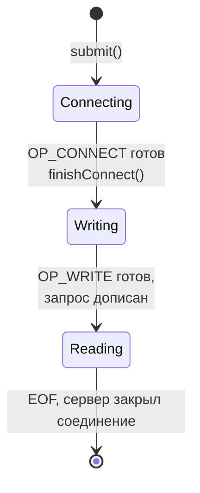

# 6. Reactor в сборе

**Reactor** — паттерн: один цикл ждёт события готовности от ОС и **диспетчеризует** каждое событие
своему обработчику.

Состояние одного запроса (`PendingExchange`) в нашей реализации — три шага:

| Состояние | Ждём | Действие | Следующий интерес |
|---|---|---|---|
| `Connecting` | `OP_CONNECT` | `channel.finishConnect()` | `OP_WRITE` |
| `Writing` | `OP_WRITE` | `channel.write(requestBuffer)`, пока не опустеет | `OP_READ` |
| `Reading` | `OP_READ` | `channel.read(...)`; накапливаем; `-1` -> завершаем `CompletableFuture` | — (канал закрыт) |

| Роль в паттерне | В нашем коде |
|---|---|
| Источник событий | `Selector` + ОС |
| Цикл событий | `Reactor.runLoop()` |
| Диспетчер | `Reactor.dispatch(key)` |
| Обработчик | ветки `isConnectable` / `isWritable` / `isReadable` |
| Состояние запроса | `PendingExchange` в `key.attachment()` |
| Результат вызывающему | `CompletableFuture<byte[]>` |
